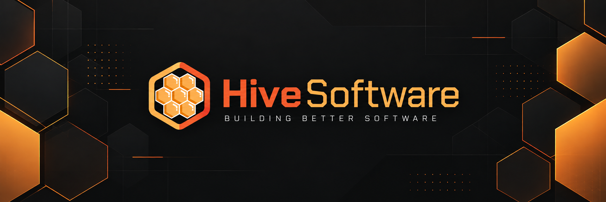

  

 

We're **Hive Software**, an independent software development company creating modern tools for server management, infrastructure monitoring, and IT administration.

Our projects range from game server management panels and mobile applications to infrastructure monitoring and enterprise management solutions.

We build both open-source and commercial software, with a shared focus on reliability, functionality, and making complicated systems easier to manage.

What started as a passion for building better software is growing into an ecosystem of products designed to make technology more accessible, manageable, and enjoyable to use.

 

### Our Products

<table>
    <tr>
        <th align="left" width="190">Product</th>
        <th align="left">Description</th>
    </tr>
    <tr>
        <td>
            <h3>🐝 HivePanel</h3>
            <a href="https://hivepanel.dev"><code>Visit Website ↗</code></a>
        </td>
        <td>
            A modern game server management panel designed for hosting providers, communities, and individuals.
              
            HivePanel focuses on performance, flexibility, and extensibility, bringing powerful server management tools together in a clean, intuitive interface.
        </td>
    </tr>
    <tr>
        <td>
            <h3>📱 HivePilot</h3>
            <code>iOS & Android</code>
        </td>
        <td>
            Game server management wherever you are.
              
            HivePilot is a mobile application for managing game servers directly from your phone, with support for Pterodactyl and planned integration with HivePanel.
              
            Built around a modern mobile experience, with free functionality and optional premium features.
        </td>
    </tr>
    <tr>
        <td>
            <h3>📊 HiveStatus</h3>
            <code>In Development</code>
        </td>
        <td>
            Infrastructure monitoring, uptime tracking, and public status pages in one platform.
              
            HiveStatus is being developed to help individuals and organizations monitor their services, track performance, detect outages, and communicate service availability.
        </td>
    </tr>
    <tr>
        <td>
            <h3>⚙️ HiveControl</h3>
            <code>In Development</code>
        </td>
        <td>
            A commercial IT management platform focused on simplifying application deployment, endpoint administration, and infrastructure operations.
              
            Designed to give IT teams greater visibility and control over their environments, while reducing the complexity of everyday management tasks.
        </td>
    </tr>
</table>

 

### Our Philosophy

We believe powerful software shouldn't have to be complicated.

Whether we're building a mobile application, a server management platform, or an enterprise solution, we follow the same principles:

- **Simplicity** - Making complex technology easier to understand and manage.
- **Reliability** - Building dependable software that users can trust.
- **Flexibility** - Creating solutions that adapt to different environments and requirements.
- **Innovation** - Exploring better ways to solve existing problems.
- **User Experience** - Putting usability and thoughtful design at the centre of everything we build.

 

### Open Source & Commercial Software

Our ecosystem includes both **open-source and proprietary software**.

We believe different projects benefit from different development and licensing approaches. Some of our software is developed openly, allowing the community to explore, contribute, and build upon it, while other products are commercially developed and maintained by Hive Software.

Regardless of the licensing model, our commitment remains the same: building useful, well-designed, and reliable software.

We welcome bug reports, feedback, and feature suggestions through the appropriate channels for each project.

 

### Sponsors & Partners

We're always interested in working with companies and individuals who share our passion for technology and software development.

Whether through infrastructure partnerships, sponsorships, or collaboration, we're open to opportunities that help our products and ecosystem grow.

<!--
Sponsor and partner entries added here

<table>
  <tr>
    <th align="left" width="235">Company</th>
    <th align="left">Description</th>
  </tr>
  <tr>
    <td>
      
    </td>
    <td>
      Partner description.
    </td>
  </tr>
</table>
-->

 

### Get Involved

Interested in what we're building?

Explore our public repositories, follow development, report issues, or share your ideas.

Not every project is open source, but feedback and community involvement remain an important part of how we improve our products.

For project-specific information, documentation, and support, please visit the relevant product website or repository.

 

### Find Us

**HivePanel:** [hivepanel.dev](https://hivepanel.dev)

**GitHub:** You're already here! Explore our repositories to see what we're working on.

<!--
Hive Software website (coming in the future):
https://hivesoftware.dev
-->

---

© Hive Software. Building better software, one project at a time.